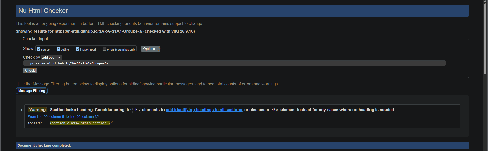
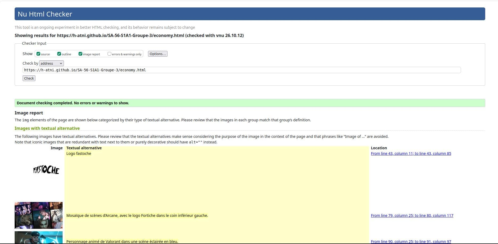
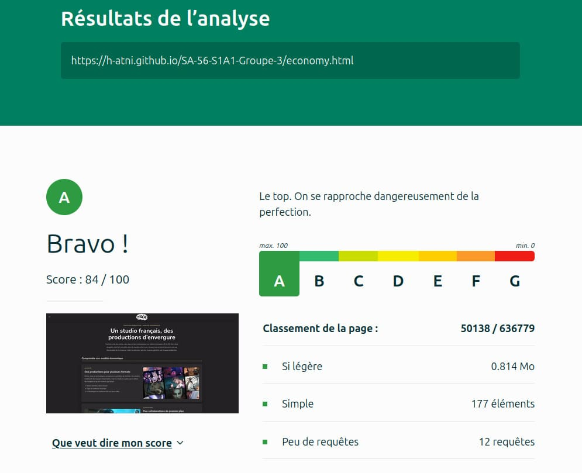

# SAÉ-56-S1A1-Groupe-3

# SAÉ FORTICHE: s1

## Sujet

SAÉ_FORTICHE
Lien du site du projet sur :
 - [Github](https://h-atni.github.io/SA-56-S1A1-Groupe-3/)
 - [BitBucket](https://aconchin.bitbucket.io./)

## Membres du groupe :
 - [Atni Hicham (référent)](hicham.atni@edu.univ-fcomte.fr)
 - [Bourgogne Arthur](arthur.bourgogne@edu.univ-fcomte.fr)
 - [Ben Ahmed Louay](louay.ben_ahmed@edu.univ-fcomte.fr)
 - [Barry Khadidiatou](khadidiatou.barry@edu.univ-fcomte.fr)
 - [Conchin August / aka. Daperkz](august.conchin@edu.univ-fcomte.fr)

## Présentation
Ce dépôt correspond à un site web créé en HTML/CSS/JS dans le cadre de la SAÉ 05-06 à l'IUT de Belfort-Montbéliard. Ce site présente des informations concernant l'entreprise FORTICHE et sert de vitrine pour présenter l'entreprise, ses activité, son organisation et son historique. Vous trouverez dans ce dépôt et sur le site un rapport économique analysant l'aspect économique de FORTICHE

## Choix de conception
Pour la conception du site, nous nous sommes grandement inspirés du site officiel de FORTICHE (trouvable [ici](https://forticheprod.com/fr/)), du site d'un de ses principaux concurrents [VIRTUOS](https://www.virtuosgames.com/fr/our-services/art-production/) et nous avons pris comme référence la charte de FORTICHE disponible [ici](doc/charte_graphique.pdf).

## Développement Site Web et Validation des pages

La validation des pages peuvent être retrouvés ci-dessous ou bien dans les [Githubs Actions](https://github.com/h-atni/SA-56-S1A1-Groupe-3/actions)

### Page d'accueil
**Auteur : Bourgogne Arthur**

Vérification W3C : [Détail ICI](https://validator.w3.org/nu/?showsource=yes&showoutline=yes&showimagereport=yes&doc=https%3A%2F%2Fdemo-am90.github.io%2Fs1-demo%2Findex.html)

ou

<!--  style="width=400px" ne fonctionne pas -->

### Présentation générale
**Auteur : Nom Prénom**

Verification W3C : [Détail ICI](https://validator.w3.org/nu/?showsource=yes&showoutline=yes&showimagereport=yes&doc=https%3A%2F%2Fdemo-am90.github.io%2Fs1-demo%2Findex.html)

 

### Page économique
**Auteur : Conchin August**

Vérification W3C : [Détail ICI](https://validator.w3.org/nu/?showsource=yes&showoutline=yes&showimagereport=yes&useragent=Validator.nu%2FLV+https%3A%2F%2Fvalidator.w3.org%2Fservices&acceptlanguage=&doc=https%3A%2F%2Fh-atni.github.io%2FSA-56-S1A1-Groupe-3%2Feconomy.html)

ou

Vérification de l'éco conception de la page : [Détail ICI](https://www.ecoindex.fr/resultat/?id=c0910b38-ef6d-4622-940c-8ccc40f296e7)

ou

### Page réalisation
**Auteur : Nom Prénom**

Verification W3C : [Détail ICI](https://validator.w3.org/nu/?showsource=yes&showoutline=yes&showimagereport=yes&doc=https%3A%2F%2Fdemo-am90.github.io%2Fs1-demo%2Findex.html)

 

### Page Equipe
**Auteur : Nom Prénom**

Verification W3C : [Détail ICI](https://validator.w3.org/nu/?showsource=yes&showoutline=yes&showimagereport=yes&doc=https%3A%2F%2Fdemo-am90.github.io%2Fs1-demo%2Findex.html)

 

## Répartition du travail

### Planification - Diagramme de GANTT

- BOURGOGNE Arthur

### Recherches d'informations

- BOURGOGNE Arthur - Mettre en avant Fortiche
- ATNI Hicham - Les projets de Fortiche
- BEN AHMED Louay - L'équipe de Fortiche
- BARRY Khadidiatou - Informations global de Fortiche
- CONCHIN August - L'aspect economique de Fortiche

### Développement site

- ATNI Hicham
  - [Page de projet](projets.html)
- BOURGOGNE Arthur
  - [Page d’accueil](index.html)
  - "Template" de page (Navbar/Footer)
- BEN AHMED Louay
  - [Page équipe](team.html)
  - footer compléter
- BARRY Khadidiatou
  - [Page de présentation](presentation.html)
- CONCHIN August
  - [Page economique](economy.html)
